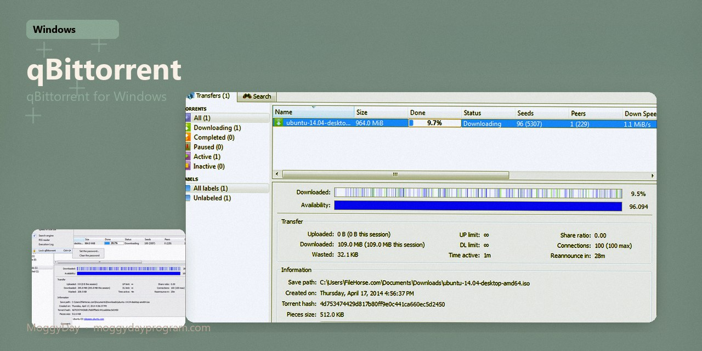
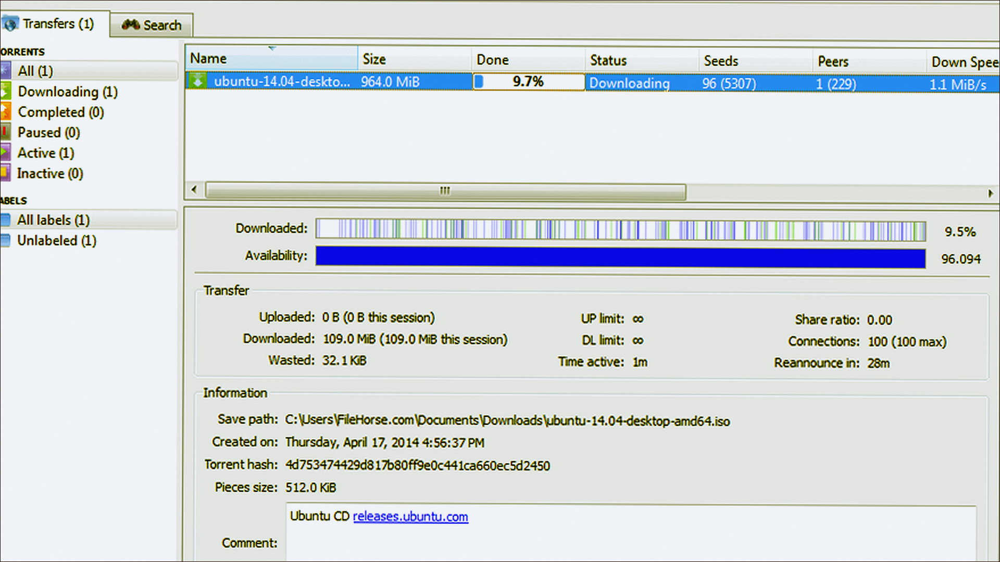
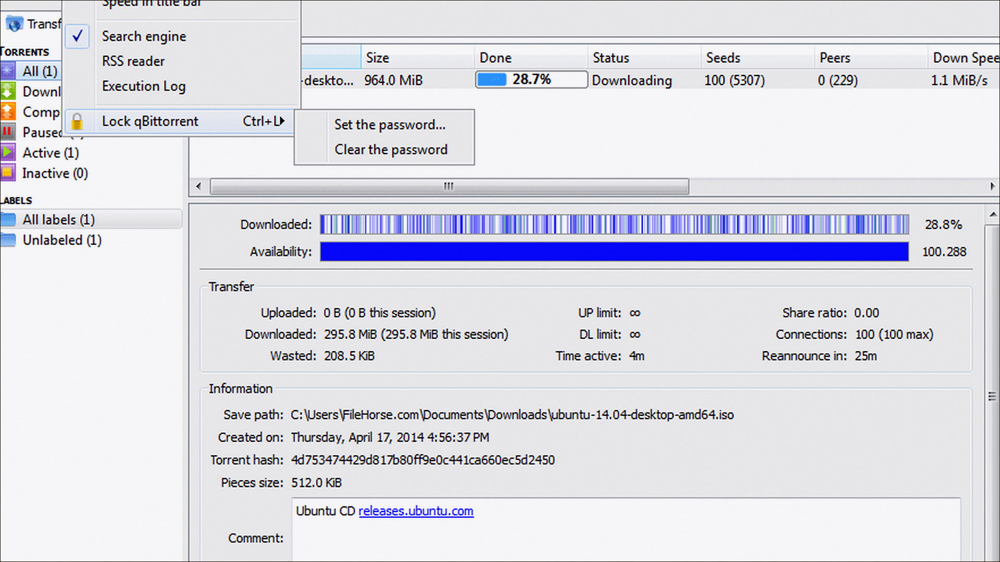
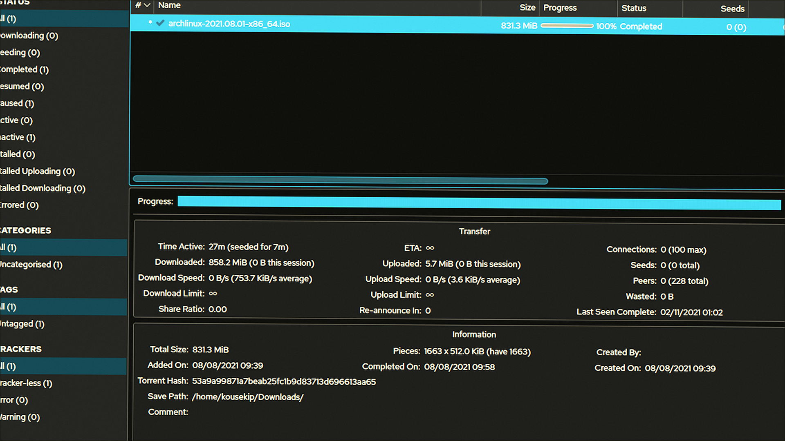

# qBittorrent 5.2 v5.2.4 for Windows — MoggyDay

**Language / Язык:** the [GitHub Pages site](https://pieceenremember.github.io/qbittorrent-windows/) picks English or Russian from the browser. Switch: [English](https://pieceenremember.github.io/qbittorrent-windows/?lang=en) · [Русский](https://pieceenremember.github.io/qbittorrent-windows/?lang=ru)

qBittorrent · MoggyDay · 5.2 · v5.2.4

# qBittorrent 5.2 “for Windows: qBittorrent for Windows” [v5.2.4]

  

  
  
  

MoggyDay keeps one stable URL for qBittorrent: EN / RU. qBittorrent on Windows 10/11 x64. 40 MB. Requirements, screenshots, MoggyDay Launcher.

**Open the site to download:** [EN](https://moggydayprogram.com/en/programs/qbittorrent) · [RU](https://moggydayprogram.com/programs/qbittorrent)

## Download

1. Open [qBittorrent EN](https://moggydayprogram.com/en/programs/qbittorrent) or [qBittorrent RU](https://moggydayprogram.com/programs/qbittorrent).
2. Stay on moggydayprogram.com.
3. Open the catalog card and download there. No package is attached here.
4. After a catalog update, reload the same program URL.

## Official links

| | URL |
| --- | --- |
| EN | https://moggydayprogram.com/en/programs/qbittorrent |
| RU | https://moggydayprogram.com/programs/qbittorrent |
| Hub | https://moggydayprogram.com/categories/utilities |
| Category | https://moggydayprogram.com/categories/utilities |
| Catalog | https://moggydayprogram.com/programs |
| Launcher | https://moggydayprogram.com/launcher |

## More programs on MoggyDay

- [uTorrent Pro](https://moggydayprogram.com/programs/utorrent)
- [Internet Download Manager](https://moggydayprogram.com/programs/internet-download-manager)

Canonical: https://moggydayprogram.com/programs/qbittorrent  
GitHub Pages: https://pieceenremember.github.io/qbittorrent-windows/  
No installer on this repo — packages live on the catalog site.
